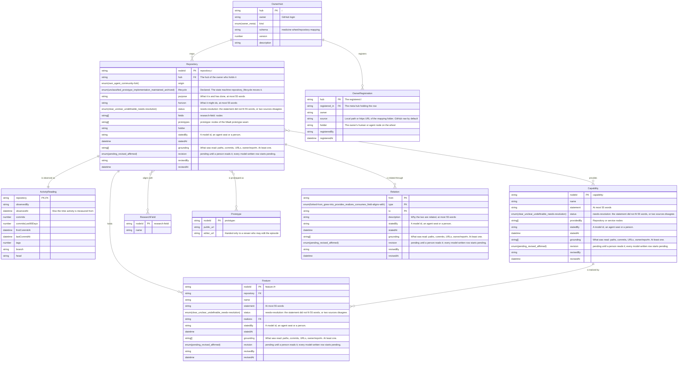
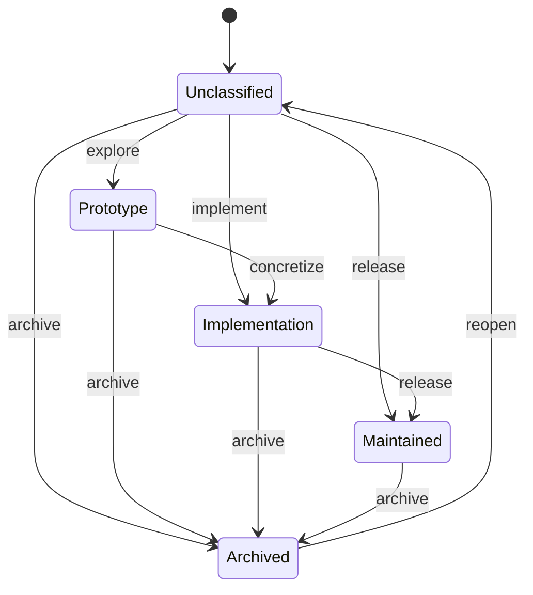
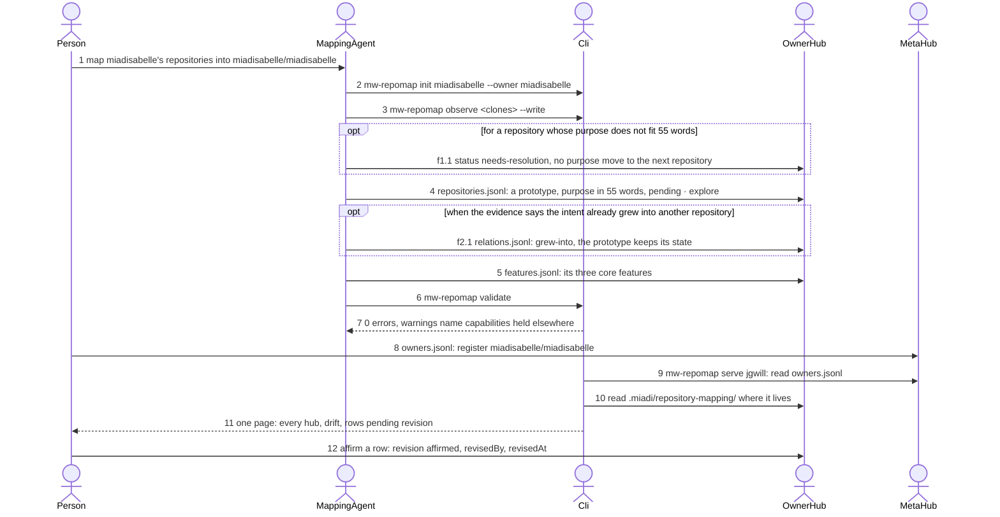

# repository-mapping — system

Repository mapping: the rows an owner hub holds, the lifecycle a repository moves through, and the meta mapping that reads several hubs without copying them.

## erd: repository-mapping.erdf.json — repository_mapping

## machine: repository-lifecycle.smdf.json — RepositoryLifecycle

## sequence: meta-mapping.sqdf.json — meta_mapping

